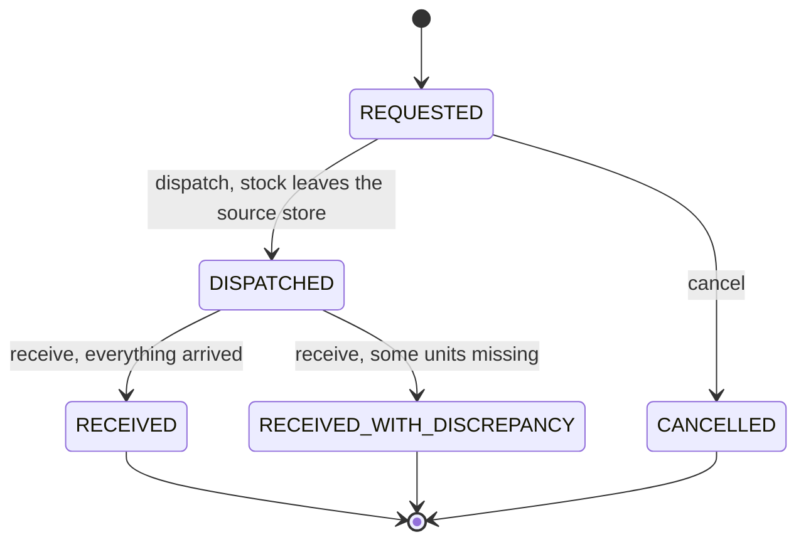

# StockFlow


A REST API for a retail chain with several stores: it books supplier deliveries, keeps stock
levels per store and moves goods between stores. Every unit that enters or leaves a store is
written to an audit ledger, so the current stock can always be explained line by line.

The interesting part is not the CRUD. It is the set of guarantees the API keeps when things go
wrong:

- **Stock never goes negative**, not even when two requests try to take the same units at the
  same moment.
- **A transfer ships completely or not at all.** If the last product on a transfer is short on
  stock, nothing leaves the store.
- **Lost goods are visible.** When fewer units arrive than were shipped, the transfer is closed
  as `RECEIVED_WITH_DISCREPANCY` and the missing units are reported per product.
- **The ledger always adds up.** For every store and product, the sum of all movements equals
  the stock on the shelf.

Each of these guarantees is covered by an automated test.

## Tech stack

Java 21, Spring Boot 4.1 (Web MVC, Data JPA, Validation, Actuator), Hibernate, Flyway,
H2 (default, in memory) or PostgreSQL, springdoc OpenAPI / Swagger UI, JUnit 5, Mockito,
AssertJ, MockMvc, JaCoCo, GitHub Actions, Docker.

## Transfer lifecycle



Any other transition (dispatching a cancelled transfer, cancelling goods that are already on
the road, receiving twice) is rejected with `409 Conflict`.

## API

| Method | Path | What it does |
|--------|------|--------------|
| POST | `/api/v1/products` | Register a product (unique SKU) |
| GET | `/api/v1/products` | List products |
| GET | `/api/v1/products/{sku}` | Get one product |
| POST | `/api/v1/stores` | Register a store (unique code) |
| GET | `/api/v1/stores` | List stores |
| GET | `/api/v1/stores/{code}` | Get one store |
| POST | `/api/v1/stores/{code}/goods-receipts` | Book a supplier delivery into a store |
| GET | `/api/v1/stores/{code}/stock` | Current stock levels of a store |
| GET | `/api/v1/stores/{code}/movements?sku=` | Ledger of a store, newest first |
| POST | `/api/v1/transfers` | Request a transfer between two stores |
| GET | `/api/v1/transfers?status=` | List transfers, optionally by status |
| GET | `/api/v1/transfers/{id}` | Get one transfer |
| POST | `/api/v1/transfers/{id}/dispatch` | Ship it: removes stock from the source store |
| POST | `/api/v1/transfers/{id}/receive` | Book what arrived into the destination store |
| POST | `/api/v1/transfers/{id}/cancel` | Cancel a transfer that has not shipped |

Interactive documentation: <http://localhost:8080/swagger-ui.html> once the app is running.

### Errors

Every error uses the standard [RFC 9457](https://www.rfc-editor.org/rfc/rfc9457) Problem
Details format (`application/problem+json`), with extra fields where they help the client:

```json
{
  "title": "Insufficient stock",
  "status": 409,
  "detail": "Store WH-01 has 1 unit(s) of CANDLE-01 but 3 were requested",
  "instance": "/api/v1/transfers/1/dispatch",
  "storeCode": "WH-01",
  "sku": "CANDLE-01",
  "requested": 3,
  "available": 1
}
```

| Status | Meaning |
|--------|---------|
| 400 | Malformed request or invalid fields (all field errors are listed in `errors`) |
| 404 | Store, product or transfer does not exist |
| 409 | Conflicts with the current state: duplicate code, not enough stock, illegal transition, concurrent update |
| 422 | Well formed but breaks a business rule, for example source and destination are the same store |

## Running it

You need **JDK 21**. Maven is not required: the Maven Wrapper (`mvnw`) downloads it.

**Windows (PowerShell)**

```powershell
.\mvnw.cmd spring-boot:run     # start the API on http://localhost:8080
.\mvnw.cmd verify              # run all tests and build the coverage report
```

**macOS / Linux**

```bash
./mvnw spring-boot:run
./mvnw verify
```

By default the app uses an in-memory H2 database, so it starts with zero setup (data is lost on
restart). To run it against PostgreSQL instead:

```bash
docker compose up --build
```

After `verify`, the coverage report is at `target/site/jacoco/index.html`.

### Try it

The quickest way is Swagger UI. With curl (also available as `curl.exe` on Windows):

```bash
curl -X POST localhost:8080/api/v1/stores -H "Content-Type: application/json" \
     -d '{"code":"WH-01","name":"Central warehouse"}'
curl -X POST localhost:8080/api/v1/stores -H "Content-Type: application/json" \
     -d '{"code":"MALL-01","name":"Mall store"}'
curl -X POST localhost:8080/api/v1/products -H "Content-Type: application/json" \
     -d '{"sku":"MUG-01","name":"Ceramic mug"}'

# A supplier delivers 20 mugs to the warehouse
curl -X POST localhost:8080/api/v1/stores/WH-01/goods-receipts -H "Content-Type: application/json" \
     -d '{"reference":"PO-2026-0001","lines":[{"sku":"MUG-01","quantity":20}]}'

# Send 8 to the mall, ship them, and report that only 6 arrived
curl -X POST localhost:8080/api/v1/transfers -H "Content-Type: application/json" \
     -d '{"sourceStoreCode":"WH-01","destinationStoreCode":"MALL-01","lines":[{"sku":"MUG-01","quantity":8}]}'
curl -X POST localhost:8080/api/v1/transfers/1/dispatch
curl -X POST localhost:8080/api/v1/transfers/1/receive -H "Content-Type: application/json" \
     -d '{"lines":[{"sku":"MUG-01","receivedQuantity":6}]}'

# Warehouse: 12 mugs. Mall: 6 mugs. Transfer 1: discrepancy of 2.
curl localhost:8080/api/v1/stores/WH-01/movements
```

## Design decisions

**Append-only stock ledger.** Stock levels live in `stock_items`, but every change also writes a
row to `stock_movements` with its type (`GOODS_RECEIPT`, `TRANSFER_OUT`, `TRANSFER_IN`) and a
reference (purchase order number or `TRF-<id>`). Rows are never updated or deleted. This is what
an auditor or a support engineer needs when someone asks "why does the system say 12?".

**One way to change stock.** `InventoryService.addStock` and `removeStock` are the only code that
touches stock, and both require an existing transaction (`Propagation.MANDATORY`). Calling them
outside a transaction fails immediately, so the stock row and its ledger row are always written
together.

**Optimistic locking plus a database constraint.** `StockItem` and `Transfer` carry a JPA
`@Version`. If two requests read the same stock and both try to save, the second one fails with
`409 Concurrent modification` instead of silently overwriting the first. As a second line of
defence, the database itself rejects negative stock (`CHECK (quantity >= 0)`).

**The state machine lives in the entity.** `Transfer.dispatch()`, `receive()` and `cancel()` check
the current status themselves, so no caller can skip a rule. The service layer only orchestrates:
load, call the domain method, move the stock.

**All or nothing.** Dispatch and goods receipt run in a single transaction. An exception on any
line rolls back the whole request, including stock already removed for earlier lines.

**Flyway owns the schema.** Tables, foreign keys, unique keys and check constraints are written by
hand in `src/main/resources/db/migration`. Hibernate is set to `ddl-auto: none` and never changes
the database, which is how it works in production.

**No lazy loading in controllers.** `open-in-view` is disabled and repositories fetch what each
use case needs (`@EntityGraph`, `join fetch`), which avoids N+1 queries and surprises.

**Testable time.** Services get the current time from an injected `Clock`, so unit tests freeze
time and assert exact timestamps.

## Tests

| Level | Examples | Tools |
|-------|----------|-------|
| Domain unit tests | Every legal and illegal transfer transition, partial receipt, overflow and negative stock | JUnit 5, AssertJ, parameterized tests |
| Service unit tests | Stock is removed for every line on dispatch; lines that did not arrive are not booked | Mockito |
| Web layer tests | Status codes, `Location` header, Problem Details body, field errors | `@WebMvcTest`, MockMvc |
| Integration tests | Full lifecycle over HTTP with the real database schema; rollback when a line is short | `@SpringBootTest`, H2, Flyway |
| Concurrency tests | Two dispatches race for the same stock: exactly one wins, stock and ledger still agree | `@SpringBootTest`, threads |

Run them all with `mvnw verify`. CI runs the same command on every push.

## Project structure

Packages are organised by feature, not by layer:

```
src/main/java/com/stockflow
├── product/     products (catalogue)
├── store/       stores
├── inventory/   stock levels, goods receipts, the ledger
├── transfer/    transfers and their state machine
├── common/      shared exceptions and request types
└── web/         error handling (Problem Details)
```

## License

MIT
